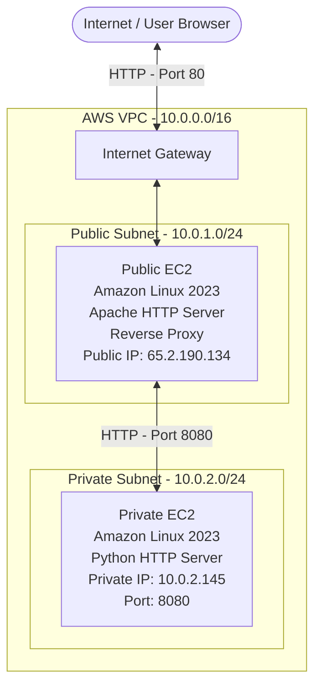

# AWS Two-Tier Architecture Using VPC, EC2, Apache Reverse Proxy and Python

## 1. Project Overview

This project demonstrates how to build a basic two-tier architecture on AWS using Amazon Virtual Private Cloud (VPC), EC2 instances, Security Groups, Apache HTTP Server and Python.

The architecture separates the internet-facing web tier from the private application tier.

The Public EC2 instance receives HTTP requests from visitors and forwards them to the Private EC2 instance through an Apache reverse proxy.

The Private EC2 instance hosts a simple webpage using Python's built-in HTTP server and is not directly accessible from the public internet.

### Project Objectives

- Create a VPC with separate public and private subnets.
- Deploy a Public EC2 instance and a Private EC2 instance.
- Configure routing and Security Groups.
- Establish SSH connectivity through a bastion/jump host.
- Configure a Python HTTP server on the Private EC2.
- Configure Apache as a reverse proxy on the Public EC2.
- Test communication between the two tiers.
- Verify end-to-end browser access through the Public EC2.

## 2. AWS Services and Technologies Used

| Service / Technology | Purpose |
|---|---|
| Amazon VPC | Provides an isolated virtual network |
| Public Subnet | Hosts the internet-facing web server |
| Private Subnet | Hosts the private application server |
| Internet Gateway | Provides internet connectivity to the public subnet |
| EC2 | Provides virtual server instances |
| Security Groups | Control inbound and outbound network traffic |
| SSH | Secure remote access to EC2 instances |
| SSH Agent Forwarding | Enables authentication to the private instance through the public instance without copying the private key |
| Apache HTTP Server | Acts as the reverse proxy |
| Python HTTP Server | Serves the webpage from the private instance |
| Amazon Linux 2023 | Operating system used by both EC2 instances |

## 3. Architecture Diagram

The following diagram represents the implemented architecture.



### Request Flow

1. A visitor opens the Public EC2's public IP address in a browser.
2. Apache on the Public EC2 receives the HTTP request on port 80.
3. Apache forwards the request to the Private EC2 using its private IP address and port 8080.
4. The Python HTTP server on the Private EC2 processes the request and returns the webpage.
5. Apache sends the response back to the visitor's browser.

The Private EC2 does not require a public IP address for this communication.

## 4. VPC and Networking Configuration

### VPC Configuration

| Configuration | Value |
|---|---|
| VPC CIDR | 10.0.0.0/16 |
| Region | Asia Pacific (Mumbai) |
| Region Code | ap-south-1 |
| Availability Zone | ap-south-1a |

### Subnet Configuration

| Subnet | CIDR Block | Purpose |
|---|---|---|
| Public Subnet | 10.0.1.0/24 | Hosts the web tier |
| Private Subnet | 10.0.2.0/24 | Hosts the application tier |

### Internet Gateway

An Internet Gateway was attached to the VPC to provide internet connectivity to resources in the public subnet through the appropriate routing configuration.

### Route Table Configuration

**Public Route Table**

| Destination | Target |
|---|---|
| 10.0.0.0/16 | local |
| 0.0.0.0/0 | Internet Gateway |

The default route allows resources in the public subnet to communicate with the internet, subject to their public IP configuration and Security Group rules.

**Private Route Table**

The private subnet uses the VPC's automatic local route for internal communication.

No NAT Gateway was configured for this project.

The private instance was able to communicate with the Public EC2 through the VPC local route without requiring a NAT Gateway.

The Private EC2's attempt to access an external HTTPS website timed out, demonstrating that outbound internet connectivity was not available during the test.

## 5. EC2 Instance Configuration

Two EC2 instances were deployed.

### Public EC2 — Web Tier

| Configuration | Value |
|---|---|
| Operating System | Amazon Linux 2023 |
| Public IPv4 | 65.2.190.134 |
| Subnet | Public Subnet |
| CIDR | 10.0.1.0/24 |
| Web Server | Apache HTTP Server |
| Apache Version | 2.4.69 |
| HTTP Port | 80 |

### Private EC2 — Application Tier

| Configuration | Value |
|---|---|
| Operating System | Amazon Linux 2023 |
| Private IPv4 | 10.0.2.145 |
| Public IPv4 | None |
| Subnet | Private Subnet |
| CIDR | 10.0.2.0/24 |
| Python Version | 3.9.25 |
| Application Server Port | 8080 |

The Private EC2 was deployed without a public IPv4 address.

It communicates with the Public EC2 through its private IP address.

## 6. Security Group Configuration

Security Groups were configured to restrict communication between the two tiers.

### Public EC2 Security Group

**Name:** web-server-sg-practice

**Security Group ID:** sg-0c36568674382de02

Inbound rules:

| Type | Protocol | Port | Source |
|---|---|---|---|
| SSH | TCP | 22 | My IP |
| SSH | TCP | 22 | Prefix list |
| HTTP | TCP | 80 | My IP |

Note: The HTTP rule was restricted to My IP during the browser demonstration. It was not opened to the entire internet.

### Private EC2 Security Group

**Name:** private-ec2-nat-test-sg

**Security Group ID:** sg-0eed9fe90840a65f6

Inbound rules:

| Type | Protocol | Port | Source |
|---|---|---|---|
| SSH | TCP | 22 | Public EC2 Security Group |
| Custom TCP | TCP | 8080 | Public EC2 Security Group |

The Private EC2 accepts SSH and application traffic from the Public EC2's Security Group.

This avoids allowing direct SSH or application access from arbitrary internet sources.

### Important Security Group Concepts Demonstrated

- Security Groups are stateful.
- Security Group references can be used as traffic sources.
- Port 22 is used for SSH.
- Port 80 is used for HTTP.
- Port 8080 is used for communication with the private application server.
- The Private EC2 does not require public inbound access.

## 7. SSH Connectivity Through a Bastion Host

The Public EC2 was used as a jump host to access the Private EC2.

SSH Agent Forwarding was configured from the local Mac system.

### Step 1: Add SSH keys to the Mac SSH Agent

```bash
ssh-add --apple-use-keychain "$HOME/Downloads/private vpc.pem"
```

```bash
ssh-add --apple-use-keychain "$HOME/Downloads/()vpc-web-server-practice.pem"
```

Verify the identities:

```bash
ssh-add -l
```

### Step 2: Connect to the Public EC2

```bash
ssh -A -i "$HOME/Downloads/()vpc-web-server-practice.pem" ec2-user@65.2.190.134
```

The `-A` option enables SSH agent forwarding.

### Step 3: Verify SSH Agent Forwarding

From the Public EC2:

```bash
ssh-add -l
```

The forwarded identities should be visible.

### Step 4: Connect to the Private EC2

```bash
ssh ec2-user@10.0.2.145
```

The connection was successful.

The private key was not copied onto the Public EC2.

### Key Learning

SSH Agent Forwarding helps with authentication, while VPC routing and Security Group rules provide network connectivity.

These are two different concepts.

## 8. Private Application Server Setup

A simple webpage was created and hosted on the Private EC2 using Python's built-in HTTP server.

### Step 1: Verify the Operating System

```bash
cat /etc/os-release
```

The instance was running Amazon Linux 2023.

### Step 2: Verify Python Installation

```bash
python3 --version
```

Output:

```text
Python 3.9.25
```

### Step 3: Verify the HTTP Server Module

```bash
python3 -m http.server --help
```

The Python HTTP server module was available.

### Step 4: Inspect the Web Demo Directory

```bash
ls -ld ~/web-demo
```

Inspect its contents:

```bash
ls -l ~/web-demo
```

The directory contained:

```text
index.html
```

### Step 5: Inspect the Webpage

```bash
cat ~/web-demo/index.html
```

The webpage content was:

```text
Hello! This page is being served from the private EC2 instance.
```

### Step 6: Start the Python HTTP Server

```bash
python3 -m http.server 8080 --bind 0.0.0.0 --directory ~/web-demo
```

Explanation:

- `python3` executes Python.
- `-m http.server` starts the built-in HTTP server module.
- `8080` specifies the listening port.
- `--bind 0.0.0.0` makes the server listen on all network interfaces.
- `--directory ~/web-demo` restricts the served directory to the web-demo folder.

Expected output:

```text
Serving HTTP on 0.0.0.0 port 8080 ...
```

The server was kept running in the foreground during testing.

Note: Python's built-in HTTP server is suitable for this learning demonstration. It is not intended as a production-grade application server.

## 9. Testing Communication Between the Two Tiers

Before configuring Apache, direct communication from the Public EC2 to the Private EC2 was tested.

From the Public EC2:

```bash
curl http://10.0.2.145:8080
```

Successful response:

```text
Hello! This page is being served from the private EC2 instance.
```

This confirmed:

- The Private EC2 HTTP server was running.
- The Public EC2 could reach the Private EC2 using its private IP.
- The Private EC2 Security Group permitted TCP port 8080 from the Public EC2 Security Group.
- The VPC's local route enabled internal communication.

A NAT Gateway was not required for this communication.

## 10. Apache Reverse Proxy Configuration

Apache was already installed and running on the Public EC2.

### Step 1: Verify Apache Version

```bash
httpd -v
```

Output:

```text
Server version: Apache/2.4.69 (Amazon Linux)
```

### Step 2: Check Apache Service Status

```bash
sudo systemctl status httpd
```

The service was confirmed as:

```text
active (running)
```

### Step 3: Verify Required Apache Modules

```bash
sudo httpd -M
```

The following modules were confirmed as loaded:

```text
proxy_module
proxy_http_module
headers_module
```

The proxy modules enable Apache to forward HTTP requests to another server.

### Step 4: Inspect Apache Configuration

```bash
sudo httpd -S
```

The main Apache DocumentRoot was:

```text
/var/www/html
```

Apache's additional configuration directory was inspected:

```bash
ls -l /etc/httpd/conf.d/
```

A separate configuration file was created to avoid unnecessarily modifying the main Apache configuration.

### Step 5: Create the Reverse Proxy Configuration

```bash
sudo nano /etc/httpd/conf.d/two-tier-proxy.conf
```

The following configuration was added:

```apache
ProxyPreserveHost On
ProxyPass / http://10.0.2.145:8080/
ProxyPassReverse / http://10.0.2.145:8080/
```

### Explanation

**ProxyPreserveHost On**

Preserves the original Host header when Apache forwards the request to the backend.

**ProxyPass /**

Forwards incoming requests to the Private EC2 application server.

**ProxyPassReverse /**

Adjusts certain response headers, such as redirects, so backend redirects can work correctly through the proxy.

### Step 6: Validate Apache Configuration

```bash
sudo apachectl configtest
```

Successful output:

```text
Syntax OK
```

### Step 7: Reload Apache

```bash
sudo systemctl reload httpd
```

Apache loaded the new reverse proxy configuration.

## 11. End-to-End Testing

After configuring the reverse proxy, the complete request flow was tested.

### Test 1: Local Reverse Proxy Test

From the Public EC2:

```bash
curl -i http://localhost/
```

Successful response:

```text
HTTP/1.1 200 OK

Server: SimpleHTTP/0.6 Python/3.9.25
Content-type: text/html; charset=UTF-8

Hello! This page is being served from the private EC2 instance.
```

The `HTTP/1.1 200 OK` response indicated a successful HTTP request.

The `Server: SimpleHTTP/0.6 Python/3.9.25` header also helped confirm that the response came from the Python server running on the Private EC2.

### Test 2: Browser-Based Testing

The Public EC2's public IP was entered into the local browser:

```text
http://65.2.190.134/
```

Successful browser response:

```text
Hello! This page is being served from the private EC2 instance.
```

This confirmed successful end-to-end communication:

```text
Browser
   |
   | HTTP - Port 80
   v
Public EC2 - Apache Reverse Proxy
   |
   | HTTP - Port 8080
   v
Private EC2 - Python HTTP Server
   |
   v
index.html
```

The response was successfully returned through Apache to the browser.

## 12. Private EC2 Isolation Verification

The Private EC2 instance was inspected through the AWS Console.

Its Public IPv4 address field displayed:

```text
—
```

This confirmed that the Private EC2 had no public IPv4 address assigned.

The instance remained reachable from the Public EC2 through its private IP:

```text
10.0.2.145
```

This demonstrated how a private application server can serve requests through a public web tier without being directly exposed through a public IPv4 address.

Note: The absence of a public IP alone does not guarantee complete isolation. Routing, Security Groups and network ACLs must also be configured appropriately.

## 13. Troubleshooting and Issues Encountered

The project involved several practical troubleshooting exercises.

### Issue 1: SSH Permission Denied

**Error:**

```text
Permission denied (publickey)
```

**Resolution:**

- Verified the EC2 key pair.
- Added the appropriate private keys to the Mac SSH agent.
- Used the correct SSH username and key.
- Enabled SSH agent forwarding with `-A`.

### Issue 2: SSH Agent Unavailable in Browser-Based EC2 Instance Connect

**Error:**

```text
Could not open a connection to your authentication agent.
```

**Learning:**

Browser-based EC2 Instance Connect and Mac Terminal SSH sessions are separate SSH sessions.

The Mac SSH agent is not automatically available in a browser-based session.

### Issue 3: Private EC2 External Internet Connectivity

**Command:**

```bash
curl -I https://www.google.com
```

**Observed result:**

```text
curl: (28) Failed to connect to www.google.com:443
```

**Learning:**

The Private EC2 did not have confirmed outbound internet connectivity during the test.

A NAT Gateway could provide outbound internet access to instances in a private subnet without assigning them public IP addresses.

However, a NAT Gateway was not necessary for the internal communication required by this project, so one was not configured.

### Issue 4: Python HTTP Server Exposed the Home Directory

The first Python server was started without specifying a dedicated directory:

```bash
python3 -m http.server 8080 --bind 0.0.0.0
```

This resulted in a directory listing containing home-directory files and folders.

**Resolution:**

The server was stopped using `Ctrl + C` and restarted with a dedicated web directory:

```bash
python3 -m http.server 8080 --bind 0.0.0.0 --directory ~/web-demo
```

This restricted the HTTP server's shared directory to `web-demo`.

### Issue 5: Apache Reverse Proxy Configuration

The Apache configuration was created as a separate file:

```text
/etc/httpd/conf.d/two-tier-proxy.conf
```

The configuration was validated before reloading Apache:

```bash
sudo apachectl configtest
```

The result was:

```text
Syntax OK
```

This helped avoid applying an invalid Apache configuration.

## 14. Key Concepts Learned

Through this hands-on project, the following AWS and networking concepts were practised:

1. VPC and CIDR addressing.
2. Public and private subnet architecture.
3. Internet Gateway and route tables.
4. VPC local routing between subnets.
5. EC2 deployment in different subnets.
6. Security Group inbound rules.
7. Security Group references as traffic sources.
8. SSH connectivity through a bastion host.
9. SSH Agent Forwarding.
10. Private IP communication.
11. HTTP and TCP port configuration.
12. Apache HTTP Server.
13. Apache reverse proxy.
14. Python built-in HTTP server.
15. End-to-end application testing.
16. Private EC2 network isolation.

## 15. Security Considerations and Future Improvements

This project demonstrates the basic architecture and connectivity concepts. The following improvements would be appropriate before considering a production deployment:

- Use HTTPS with a valid TLS certificate.
- Restrict SSH access to trusted sources and consider Systems Manager Session Manager instead of direct SSH.
- Use a production-grade application server instead of Python's built-in HTTP server.
- Consider an Application Load Balancer for scalable web traffic.
- Use a NAT Gateway or suitable VPC endpoints if private instances require external services or package downloads.
- Configure monitoring and logging using Amazon CloudWatch.
- Review Security Group outbound rules and network ACLs.
- Consider deploying instances across multiple Availability Zones for high availability.
- Avoid exposing unnecessary files or sensitive information through the web server.
- Stop or terminate resources when they are no longer required to avoid unnecessary AWS charges.

## 16. Project Outcome

Successfully implemented and tested a basic AWS two-tier architecture.

The Public EC2 instance acted as the web tier using Apache HTTP Server as a reverse proxy.

The Private EC2 instance hosted a webpage using Python's built-in HTTP server on port 8080.

Communication between the two instances was successfully established using their private network connectivity and Security Group references.

The final browser-based test was successful, and the Private EC2 was verified to have no public IPv4 address.

**Final Result:**

```text
Internet Visitor
       |
       v
Public EC2 - Apache Reverse Proxy
       |
       v
Private EC2 - Python HTTP Server
       |
       v
Webpage Successfully Displayed
```

**Project Status: Successfully implemented and end-to-end tested.**

