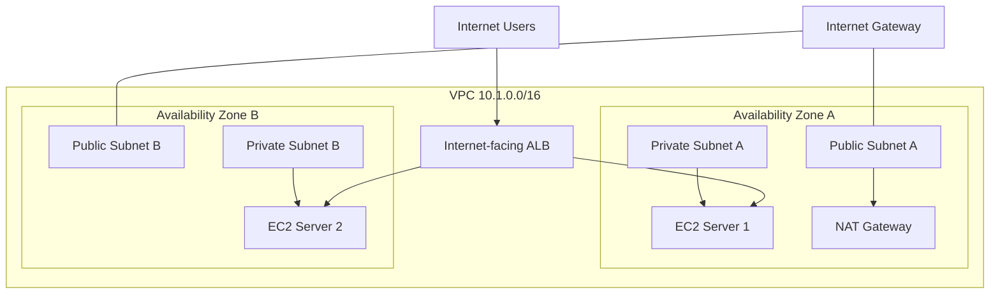

# AWS Application Load Balancer with Private EC2 Targets

## 1. Project Overview

### Problem Statement

Running a web application on a single EC2 instance creates a potential single point of failure.

If that instance becomes unavailable, users may lose access to the application. A single instance can also become overloaded when traffic increases.

To address these challenges, I built an AWS architecture using an **Application Load Balancer (ALB)** and two EC2 web servers deployed across separate Availability Zones.

### Project Objectives

- Distribute incoming HTTP traffic across multiple EC2 instances.
- Improve application availability using multiple Availability Zones.
- Keep backend EC2 instances in private subnets.
- Configure health checks to identify healthy targets.
- Test traffic distribution and failure recovery.
- Understand how AWS networking components work together.

## 2. Architecture

### AWS Resources Used

| Resource | Configuration |
|---|---|
| Region | Mumbai (`ap-south-1`) |
| VPC | `alb-private-lab-vpc` |
| VPC CIDR | `10.1.0.0/16` |
| Availability Zones | `ap-south-1a`, `ap-south-1b` |
| Internet Gateway | `alb-private-lab-igw` |
| NAT Gateway | `alb-private-lab-nat` |
| Application Load Balancer | `alb-private-lab` |
| Target Group | `alb-private-tg` |
| EC2 Instance 1 | `alb-web-server-1` |
| EC2 Instance 2 | `alb-web-server-2` |

### Subnet Design

| Subnet | CIDR | Availability Zone | Purpose |
|---|---|---|---|
| Public A | `10.1.1.0/24` | `ap-south-1a` | ALB and NAT Gateway |
| Public B | `10.1.2.0/24` | `ap-south-1b` | ALB |
| Private A | `10.1.3.0/24` | `ap-south-1a` | EC2 Server 1 |
| Private B | `10.1.4.0/24` | `ap-south-1b` | EC2 Server 2 |

### Architecture Diagram



## 3. Network Configuration

### Internet Gateway

An Internet Gateway was attached to the VPC to enable internet connectivity for resources in public subnets.

### Public Route Table

The public route table contained:

- Local route: `10.1.0.0/16`
- Internet route: `0.0.0.0/0` pointing to the Internet Gateway.

It was associated with both public subnets.

### Private Route Table

The private route table contained:

- Local route: `10.1.0.0/16`
- Internet route: `0.0.0.0/0` pointing to the NAT Gateway.

It was associated with both private subnets.

The NAT Gateway allowed private EC2 instances to initiate outbound internet connections without assigning them public IP addresses.

## 4. Security Group Configuration

### ALB Security Group: `alb-sg`

Inbound:
- HTTP, port 80, from `0.0.0.0/0`.

Outbound:
- Default outbound rules.

### EC2 Security Group: `alb-ec2-sg`

Inbound:
- HTTP, port 80, with the source set to the ALB security group.

Outbound:
- Default outbound rules.

This configuration allowed web traffic from the ALB to reach the EC2 instances without allowing direct public HTTP access to the backend instances.

No SSH access was configured.

## 5. EC2 Web Servers

Two Amazon Linux 2023 EC2 instances were launched:

- `alb-web-server-1` in Private Subnet A.
- `alb-web-server-2` in Private Subnet B.

Both instances used the `t3.micro` instance type and had no public IP address.

Apache HTTP Server was installed using EC2 User Data.

Each server displayed a different message:

**Server 1:**
```html
<h1>Hello from Server 1</h1>
```

**Server 2:**
```html
<h1>Hello from Server 2</h1>
```

Different responses made it easy to identify which backend server handled a request.

## 6. Target Group Configuration

A target group named `alb-private-tg` was created.

Configuration:

- Target type: Instances
- Protocol: HTTP
- Port: 80
- Health check protocol: HTTP
- Health check path: `/`
- Success codes: `200`

Both EC2 instances were registered as targets.

After the application started successfully, both targets showed a **Healthy** status.

## 7. Application Load Balancer Configuration

An internet-facing Application Load Balancer named `alb-private-lab` was created.

Configuration:

- Scheme: Internet-facing
- IP address type: IPv4
- Availability Zones: `ap-south-1a` and `ap-south-1b`
- Subnets: Both public subnets
- Security group: `alb-sg`

An HTTP listener was configured:

- Listener protocol: HTTP
- Listener port: 80
- Default action: Forward to `alb-private-tg`

The ALB received incoming requests and forwarded them to healthy registered targets.

## 8. Testing and Validation

### Test 1: Target Health

Verified that both EC2 instances were registered and showed Healthy in the target group.

### Test 2: Traffic Distribution

Opened the ALB DNS name in a browser and refreshed the page multiple times.

Observed responses from both servers:

- Hello from Server 1
- Hello from Server 2

This confirmed that the ALB was distributing requests across the registered healthy targets.

The ALB does not guarantee strict alternating responses because connection reuse and its routing behavior can affect what appears in the browser.

### Test 3: Failure Recovery

Stopped `alb-web-server-1` to simulate an instance failure.

Observed:

- Server 1 changed to Unused because the EC2 instance was stopped.
- Server 2 remained Healthy.
- Requests through the ALB continued reaching Server 2.

Restarted Server 1.

After it passed the configured health checks, its target status returned to Healthy and it became eligible to receive traffic again.

**Result:** The failure and recovery test was successful.

## 9. Key Concepts Learned

- An ALB distributes application traffic across registered targets.
- A listener receives incoming connections.
- Listener rules determine how requests are handled.
- A target group identifies the backend destinations.
- Health checks determine target eligibility for normal routing.
- Private EC2 instances can receive traffic through an internet-facing ALB.
- Security group references can restrict backend access to the ALB.
- Deploying resources across multiple Availability Zones improves resilience against an individual AZ failure.
- NAT Gateway provides outbound internet connectivity for private subnet resources.
- EC2 instance status checks and ALB target health checks measure different things.

## 10. Cost Awareness and Cleanup

This was a temporary learning lab.

After completing the tests, I deleted the resources to avoid unnecessary ongoing AWS charges.

Cleanup included:

- Application Load Balancer
- Target group
- EC2 instances
- NAT Gateway
- Associated Elastic IP
- Custom route tables
- Lab security groups
- Internet Gateway
- Four subnets
- Lab VPC

## 11. Conclusion

This project helped me understand how an Application Load Balancer works with EC2 instances, target groups, health checks, security groups, subnets, and Availability Zones.

I successfully tested traffic distribution, simulated an EC2 failure, observed how the ALB handled the remaining healthy target, and verified recovery after restarting the failed instance.

The project provided practical experience with AWS load balancing, networking, high availability, and infrastructure cleanup.

## 12. Lessons Learned

During this hands-on project, I learned several important lessons:

1. **An ALB does not require public EC2 instances.** An internet-facing ALB can receive requests from the internet and forward them to EC2 instances in private subnets.

2. **Healthy targets matter.** The ALB uses health checks to determine which targets are eligible to receive normal traffic.

3. **High availability requires multiple Availability Zones.** Deploying backend instances across separate AZs helps protect an application against an individual instance or AZ failure.

4. **Security group references improve security.** Instead of allowing HTTP traffic from anywhere, backend EC2 instances can accept traffic only from the ALB security group.

5. **NAT Gateway and Internet Gateway serve different purposes.** The Internet Gateway enables internet connectivity for public resources, while the NAT Gateway allows private resources to initiate outbound internet connections.

6. **Failure recovery can be automatic.** When a previously unhealthy target recovers and passes its health checks, it can become eligible for traffic again without manual re-registration.

7. **AWS resource cleanup is important.** Load balancers, NAT Gateways, and public IPv4 addresses can incur charges. Deleting unused resources is an important part of managing cloud infrastructure.

