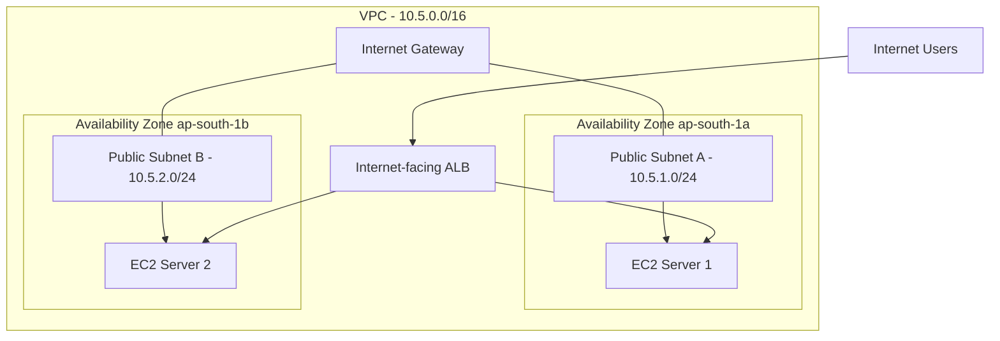

# AWS Application Load Balancer with Public EC2 Targets and Restricted Security Groups

## 1. Project Overview

### Problem Statement

An Application Load Balancer (ALB) can distribute incoming application traffic across multiple EC2 instances deployed in different Availability Zones.

In this project, I explored an alternative to my previous ALB architecture, where the backend EC2 instances were deployed in private subnets.

This time, I deployed EC2 instances in public subnets but restricted direct HTTP access using security group references.

The objective was to understand how an internet-facing ALB can securely communicate with public EC2 instances without allowing users to bypass the load balancer.

### Project Objectives

- Deploy an internet-facing Application Load Balancer.
- Deploy two EC2 web servers across separate Availability Zones.
- Place both EC2 instances in public subnets.
- Restrict HTTP access to EC2 instances so that only the ALB security group can communicate with them.
- Configure target groups and health checks.
- Test traffic distribution across both servers.
- Test direct EC2 access restrictions.
- Simulate an EC2 instance failure and verify recovery.
- Understand why a NAT Gateway is not required for this architecture.

## 2. Architecture

### AWS Resources Used

| Resource | Configuration |
|---|---|
| Region | Mumbai (`ap-south-1`) |
| VPC CIDR | `10.5.0.0/16` |
| Availability Zones | `ap-south-1a`, `ap-south-1b` |
| Public Subnet A | `10.5.1.0/24` |
| Public Subnet B | `10.5.2.0/24` |
| Internet Gateway | Attached to the VPC |
| Application Load Balancer | `alb-part2-public-lab` |
| Target Group | `alb-part2-tg` |
| EC2 Instance 1 | `alb-part2-web-server-1` |
| EC2 Instance 2 | `alb-part2-web-server-2` |
| Instance Type | `t3.micro` |
| Operating System | Amazon Linux 2023 |

### Subnet Design

| Subnet | CIDR | Availability Zone | Purpose |
|---|---|---|---|
| Public Subnet A | `10.5.1.0/24` | `ap-south-1a` | ALB and EC2 Server 1 |
| Public Subnet B | `10.5.2.0/24` | `ap-south-1b` | ALB and EC2 Server 2 |

Both subnets were configured to automatically assign public IPv4 addresses.

### Architecture Diagram



Both EC2 instances have public IPv4 addresses, but their security group restricts inbound HTTP traffic to the ALB security group.

## 3. Network Configuration

### Internet Gateway

An Internet Gateway was created and attached to the VPC.

### Public Route Table

A custom route table was configured with:

- Local route: `10.5.0.0/16`
- Internet route: `0.0.0.0/0` pointing to the Internet Gateway.

Both public subnets were associated with this route table.

### NAT Gateway

No NAT Gateway was created in this project.

Since the EC2 instances were deployed in public subnets, had public IPv4 addresses, and had a route to the Internet Gateway, a NAT Gateway was unnecessary for their internet connectivity.

This helped demonstrate the difference between public and private subnet architectures.

## 4. Security Group Configuration

### ALB Security Group: `alb-part2-sg`

Inbound rules:

| Type | Protocol | Port | Source |
|---|---|---|---|
| HTTP | TCP | 80 | `0.0.0.0/0` |

Outbound rules:

- Default outbound rule allowing all traffic.

This allows internet users to send HTTP requests to the ALB.

### EC2 Security Group: `alb-part2-ec2-sg`

Inbound rules:

| Type | Protocol | Port | Source |
|---|---|---|---|
| HTTP | TCP | 80 | `alb-part2-sg` security group |

Outbound rules:

- Default outbound rule allowing all traffic.

The EC2 security group references the ALB security group instead of allowing HTTP traffic from `0.0.0.0/0`.

This means:

- The ALB can communicate with the EC2 instances.
- Direct HTTP requests from internet users to the EC2 public IP addresses are blocked.
- Backend instances are protected from direct public HTTP access.

A temporary EC2 Instance Connect SSH rule was added during troubleshooting. It was intended only for administrative access and was not part of the final security design.

## 5. EC2 Web Servers

Two Amazon Linux 2023 EC2 instances were launched.

- `alb-part2-web-server-1` in Public Subnet A.
- `alb-part2-web-server-2` in Public Subnet B.

Both instances used:

- Instance type: `t3.micro`
- Security group: `alb-part2-ec2-sg`
- Public IPv4 addressing
- No EC2 key pair.

### Apache Installation

The initial User Data bootstrap attempt did not execute successfully.

Cloud-init logs showed an `Exec format error` when attempting to execute the User Data script.

The exact cause was not conclusively identified.

Apache was subsequently installed manually on both instances using EC2 Instance Connect.

The Apache service was enabled and started.

Each server displayed a different HTML message.

Server 1:

```html
<h1>Hello from ALB Part 2 - Server 1</h1>
<p>Public EC2 target in ap-south-1a</p>
```

Server 2:

```html
<h1>Hello from ALB Part 2 - Server 2</h1>
<p>Public EC2 target in ap-south-1b</p>
```

Different responses made it possible to identify which backend server handled each request.

## 6. Target Group Configuration

A target group named `alb-part2-tg` was created.

Configuration:

- Target type: Instances
- Protocol: HTTP
- Port: 80
- Health check protocol: HTTP
- Health check port: Traffic port
- Health check path: `/`
- Success codes: `200`

Both EC2 instances were registered with the target group on port 80.

After Apache was correctly configured to return HTTP 200, both targets showed a Healthy status.

## 7. Application Load Balancer Configuration

An internet-facing Application Load Balancer named `alb-part2-public-lab` was created.

Configuration:

- Scheme: Internet-facing
- IP address type: IPv4
- Availability Zones: `ap-south-1a` and `ap-south-1b`
- Subnets: Both public subnets
- Security group: `alb-part2-sg`

An HTTP listener was configured:

- Listener protocol: HTTP
- Listener port: 80
- Default action: Forward to `alb-part2-tg`

The ALB received incoming HTTP requests and forwarded them to healthy registered EC2 targets.

## 8. Testing and Validation

### Test 1: Target Health

Opened the target group and verified that both EC2 instances showed Healthy.

Result: Successful.

### Test 2: Traffic Distribution

Opened the ALB DNS name in a browser and refreshed the page multiple times.

Observed responses from both servers:

- Server 1
- Server 2

This confirmed that the ALB was distributing requests across both healthy targets.

The ALB does not guarantee strict alternating responses because connection reuse and its routing behaviour can affect the sequence observed in a browser.

Result: Successful.

### Test 3: Direct EC2 Access Restriction

Attempted to access Server 1 directly using its public IPv4 address:

```text
http://SERVER-1-PUBLIC-IP
```

The browser returned a connection timeout.

This was expected because the EC2 security group allowed inbound HTTP only from the ALB security group.

Result: Successful. Direct public HTTP access to the backend was blocked.

### Test 4: Failure Recovery

Stopped `alb-part2-web-server-1` to simulate an EC2 instance failure.

Observed:

- Server 1 became unavailable.
- Server 2 remained Healthy.
- Requests through the ALB continued displaying Server 2's content.

This demonstrated that the ALB continued routing requests to the remaining healthy target.

### Test 5: Instance Recovery

Started `alb-part2-web-server-1` again.

After the instance passed its health checks, its target status returned to Healthy.

Refreshed the ALB DNS name and confirmed that Server 1's content was visible again.

Result: Successful. The recovered target automatically became eligible for traffic without manual re-registration.

## 9. Key Concepts Learned

- An internet-facing ALB can distribute traffic to EC2 instances in public or private subnets.
- Public IP addressing does not automatically make an EC2 application publicly accessible.
- Security group references can restrict backend HTTP access to the ALB.
- Public subnet resources can use an Internet Gateway for internet connectivity.
- A NAT Gateway is not required for EC2 instances that have public IP addresses and use an Internet Gateway route.
- Target groups identify backend destinations.
- Health checks determine which registered targets are eligible for normal traffic.
- An ALB can continue serving requests when one target becomes unhealthy, provided another healthy target is available.
- A recovered target can automatically become eligible for traffic after passing its health checks.
- Deploying instances across multiple Availability Zones improves resilience against individual instance or Availability Zone failures.
- EC2 instance status checks and ALB target health checks measure different things.
- User Data and cloud-init logs are useful for investigating first-boot configuration issues.

## 10. Cost Awareness and Cleanup

This was a temporary learning lab.

The following resources were created and are scheduled for deletion after documentation:

- Application Load Balancer
- Target group
- Two EC2 instances
- Custom route table
- ALB security group
- EC2 security group
- Internet Gateway
- Two public subnets
- Lab VPC

No NAT Gateway or Elastic IP was created for this project.

Cleanup will be completed after documenting and publishing this project.

## 11. Conclusion

This project helped me understand how an Application Load Balancer works with public EC2 instances while maintaining restricted backend access through security group references.

I successfully deployed two web servers across separate Availability Zones, configured an internet-facing ALB, verified traffic distribution, blocked direct HTTP access to the EC2 instances, and tested instance failure and recovery.

Compared with my previous ALB project using private EC2 targets, this project demonstrated how public EC2 instances can still be protected from direct inbound application traffic through appropriate security group configuration.

## 12. Lessons Learned

1. **Public subnet does not mean unrestricted access.** Security groups determine which inbound connections are allowed.

2. **Security group references are useful.** Allowing HTTP only from the ALB security group prevents users from bypassing the load balancer.

3. **NAT Gateway is not always required.** Public EC2 instances with public IPv4 addresses and an Internet Gateway route can access the internet without NAT.

4. **Health checks support automatic recovery.** The ALB can stop routing normal traffic to unhealthy targets and automatically use them again after they recover and pass health checks.

5. **Multiple Availability Zones improve resilience.** Deploying backend instances in separate AZs helps protect an application against individual instance or AZ failures.

6. **User Data execution should be verified.** A completed cloud-init process does not necessarily mean that the User Data script succeeded.

7. **Cost awareness matters.** Temporary AWS resources should be deleted after testing to avoid unnecessary charges.
